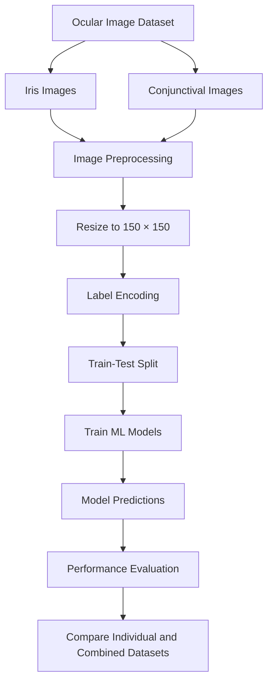

# 🩺 Machine Learning Techniques for Diabetes Detection Using Iris and Conjunctival Images

### Exploring AI-powered, non-invasive approaches to diabetes screening through ocular image analysis.

<p align="center">
  
  
  
  
</p>

---

## 🔬 Project Overview

Can subtle patterns in the human eye help identify people who may be at risk of diabetes?

This project explores the potential of **machine learning and ocular image analysis** to distinguish between diabetic and non-diabetic cases using iris and conjunctival images.

The approach combines image preprocessing, feature analysis, and supervised machine learning algorithms to investigate whether ocular images can provide useful signals for non-invasive diabetes screening research.

By evaluating models on individual image datasets and a combined dataset, the project investigates the potential of computer vision as a supporting tool for future healthcare research.

> **Research objective:** Explore an image-based screening approach that could complement conventional diabetes assessment, subject to further clinical validation.

## ✨ Key Highlights

- 👁️ **Two ocular image types:** Iris and conjunctival images.
- 🗂️ **1,372 images:** 800 iris images and 572 conjunctival images.
- ⚙️ **Computer vision pipeline:** Grayscale conversion, Otsu thresholding, morphological operations, contour detection, and masking.
- 🤖 **Six machine learning approaches:** Decision Tree, Support Vector Machine, K-Nearest Neighbors, Random Forest, Naive Bayes, and Gradient Boosting.
- 📊 **Comparative evaluation:** Separate and combined image-based classification experiments.
- 🎯 **Best reported accuracy:** 96.78% for the combined iris and conjunctival image experiment using a polynomial-kernel SVM.

---

## 📊 Results at a Glance

The following results are the accuracy values reported for the project's experiments.

| Dataset | Model | Reported Accuracy |
|---|---|---:|
| Iris images | Polynomial SVM | 95.00% |
| Iris images | Random Forest | 94.00% |
| Conjunctival images | Polynomial SVM | 93.30% |
| Conjunctival images | Random Forest | 93.00% |
| Combined iris and conjunctival images | Polynomial SVM | **96.78%** |
| Combined iris and conjunctival images | Random Forest | 94.00% |

### 🏆 Best reported result

**Polynomial-kernel Support Vector Machine — 96.78% accuracy**

The combined-image experiment achieved the highest reported accuracy among the results listed above.

These figures represent experimental results, not independently verified clinical performance. Their reliability depends on the train/test split, subject-level separation, preprocessing, class balance, and evaluation methodology.

---

## 🧠 Why This Project Matters

Diabetes is a major global public health challenge. Many people live with the condition without knowing it, making accessible screening and timely clinical assessment important.

Conventional diabetes diagnosis relies on established clinical tests, including:

- **HbA1c:** Estimates average blood glucose over approximately two to three months.
- **Fasting plasma glucose:** Measures blood glucose after fasting.
- **Oral glucose tolerance test:** Evaluates the body's response to a glucose load.
- **Random plasma glucose:** Measures blood glucose without requiring fasting.

This project investigates a complementary research direction: whether image-based machine learning could eventually support preliminary screening workflows.

### Why explore machine learning?

- **Automated analysis:** Process image data using repeatable computational methods.
- **Pattern discovery:** Investigate visual patterns that may not be obvious during manual inspection.
- **Scalable research:** Evaluate the feasibility of image-based workflows across larger datasets.
- **Potential accessibility:** Explore approaches that could eventually support screening in resource-constrained settings.

*Important: Iris and conjunctival image analysis is not an established replacement for blood glucose testing. This project does not establish that ocular images can reliably diagnose diabetes.*

---

## 🗂️ Dataset

The experiments use ocular image data collected from JNMCH, as described in the project documentation.

| Dataset | Number of Images | Classification |
|---|---:|---|
| Iris images | 800 | Diabetic / Non-diabetic |
| Conjunctival images | 572 | Diabetic / Non-diabetic |
| **Total** | **1,372** | Binary classification |

### Dataset considerations

- Images are grouped into diabetic and non-diabetic categories.
- Iris and conjunctival datasets are examined independently.
- A combined-image experiment investigates performance across both image types.
- Image dimensions are standardized to 150 × 150 pixels in the documented pipeline.

The dataset's subject distribution, class balance, demographic composition, and collection protocol should be documented before making claims about generalization.

**Data availability:** Confirm whether the dataset can be redistributed before publishing it. Patient-related image data should only be shared when the appropriate permissions, consent, and de-identification requirements have been satisfied.

---

## ⚙️ Methodology

The project follows a machine learning workflow from image preparation to comparative model evaluation.



### 1. Image preprocessing

The documented iris preprocessing workflow includes:

1. **Grayscale conversion:** Reduce the image to a single intensity channel.
2. **Otsu's thresholding:** Separate regions according to image intensity.
3. **Morphological operations:** Apply erosion and dilation to help reduce noise and refine image regions.
4. **Contour detection:** Identify candidate boundaries in the thresholded image.
5. **Mask generation:** Create a mask around the selected iris contour.
6. **Image masking:** Isolate the region of interest for subsequent analysis.

Conjunctival images are also included in the image classification experiments. Their precise preprocessing procedure should be documented alongside the implementation.

### 2. Image standardization

Images are resized to **150 × 150 pixels** to provide consistent input dimensions.

Standardization helps ensure that images can be processed in a consistent format during the model training workflow.

### 3. Label encoding

The diabetic and non-diabetic labels are transformed into numerical values suitable for supervised classification.

### 4. Dataset splitting

The dataset is separated into training and testing subsets to evaluate model performance on held-out data.

For medical image research, splitting by **individual subject rather than individual image** is especially important when a subject contributes multiple images. This helps reduce data leakage and produces a more realistic evaluation.

### 5. Model training

The project evaluates multiple supervised machine learning algorithms to compare their classification performance.

### 6. Model evaluation

Model predictions are compared with the corresponding reference labels. Accuracy is reported for the experiments summarized in this README.

A more complete evaluation should also include sensitivity, specificity, precision, recall, F1-score, confusion matrices, and ROC-AUC where appropriate.

---

## 🤖 Machine Learning Algorithms

| Algorithm | Purpose |
|---|---|
| Decision Tree | Learns interpretable decision rules from features |
| Support Vector Machine | Finds classification boundaries; includes a polynomial-kernel experiment |
| K-Nearest Neighbors | Classifies samples using nearby observations |
| Random Forest | Combines predictions from multiple decision trees |
| Naive Bayes | Applies probabilistic classification based on feature assumptions |
| Gradient Boosting | Builds an ensemble of sequentially improved predictive models |

The comparison helps investigate which of the evaluated algorithms performs best under the project's experimental setup.

---

## 🔍 Exploratory Data Analysis

The project investigates patterns in the available image data and associated subject information.

Potential analysis areas include:

- Distribution of diabetic and non-diabetic samples.
- Age distribution, where reliable demographic data are available.
- Differences between iris and conjunctival image datasets.
- Relationships between extracted image features and class labels.
- Comparative performance of machine learning algorithms.

Exploratory analysis should be used to identify potential dataset biases and quality issues, rather than to infer causation.

---

## 📈 Interpreting the Results

The reported experiments suggest that the polynomial-kernel SVM performed best among the listed configurations, particularly in the combined-image experiment.

However, **accuracy alone does not establish clinical usefulness**.

For example, a model can achieve high accuracy while missing a meaningful proportion of diabetic cases, especially when the dataset has an imbalanced class distribution.

Further validation should examine:

- **Sensitivity:** How many diabetic cases are correctly identified?
- **Specificity:** How many non-diabetic cases are correctly identified?
- **Precision:** How many predicted positive cases are actually positive?
- **F1-score:** How well does the model balance precision and recall?
- **ROC-AUC:** How effectively does the model distinguish between classes across thresholds?
- **External validation:** Does performance hold on an independent dataset collected at another site?

The combined-image experiment also requires careful documentation of how iris and conjunctival samples were paired or combined and whether the same individuals appear across datasets or splits.

---

## 🚀 Future Improvements

### 1. Advanced computer vision

Investigate CNN-based classifiers, transfer learning, and pretrained vision models to learn image representations directly.

### 2. Stronger evaluation methodology

Use subject-level train/test separation, stratified validation, reproducible random seeds, and an independent test set.

### 3. Explainable AI

Explore methods such as Grad-CAM for deep learning models or feature importance for suitable classical models, helping researchers investigate which image regions or features influence predictions.

### 4. Dataset expansion

Evaluate larger and more diverse datasets covering different demographics, acquisition conditions, and clinical settings.

### 5. Model robustness

Test sensitivity to image quality, illumination, camera differences, noise, and preprocessing choices.

### 6. Clinical validation

Collaborate with qualified healthcare professionals to assess the research approach against accepted diagnostic reference standards.

### 7. Reproducible experiments

Document dependencies, preprocessing parameters, model configurations, evaluation scripts, and experiment results so others can reproduce the reported findings.

---

## 🛠️ Getting Started

### Prerequisites

The documented workflow is based on Python-compatible machine learning and computer vision techniques. The exact dependency versions should be taken from the repository's environment or dependency files.

Typical packages for this type of workflow include:

- Python
- OpenCV
- NumPy
- Pandas
- Matplotlib
- Seaborn
- Scikit-learn

These are suggested dependencies for the described techniques; verify them against the actual source code before installation.

### 1. Clone the repository

```bash
git clone https://github.com/esana1/Diabetes-Detection-Using-ML.git
```

### 2. Enter the project directory

```bash
cd Diabetes-Detection-Using-ML
```

### 3. Create a virtual environment

```bash
python -m venv .venv
```

Activate it on Windows:

```bash
.venv\Scripts\activate
```

On macOS or Linux:

```bash
source .venv/bin/activate
```

### 4. Install dependencies

If the repository contains a `requirements.txt` file:

```bash
pip install -r requirements.txt
```

Otherwise, inspect the notebooks and Python files to determine the required package versions before installing dependencies.

### 5. Prepare the dataset

Place the authorized dataset in the directory structure expected by the project's scripts or notebooks. Update dataset paths as necessary.

Do not commit private patient images, credentials, or restricted clinical data to a public repository.

### 6. Run the experiments

Open the repository's available Jupyter notebooks or Python scripts and follow the execution order documented in the project files.

**Note:** Exact notebook names, script commands, and directory paths should be added after verifying the current repository contents.

---

## 📁 Suggested Repository Structure

The following structure is a recommendation for improving project organization, not a claim about the repository's current files.

```text
Diabetes-Detection-Using-ML/
├── data/
│   ├── iris/
│   └── conjunctiva/
├── notebooks/
│   ├── exploratory_data_analysis.ipynb
│   ├── iris_preprocessing.ipynb
│   ├── conjunctiva_analysis.ipynb
│   └── model_comparison.ipynb
├── src/
│   ├── preprocessing.py
│   ├── feature_extraction.py
│   ├── train.py
│   └── evaluate.py
├── results/
│   ├── figures/
│   └── metrics/
├── requirements.txt
├── README.md
└── LICENSE
```


See the original repository for the project implementation and contribution details.

## ⚕️ Medical Disclaimer

This project is intended for educational and research purposes only. It is not a medical device, has not been established as a clinically validated diabetes diagnostic system, and must not be used to diagnose, rule out, or treat diabetes.

The reported accuracy values are experimental results and may not generalize to other populations or clinical settings. Diabetes screening and diagnosis should follow established clinical guidelines and be performed by qualified healthcare professionals.

## 📄 License

A license has not been specified in this README. Check the repository for an existing license before reusing, modifying, or redistributing its code or data.

## 🌟 Support the Project

If you find this research useful:

- ⭐ Star the repository.
- 🍴 Fork it to explore improvements.
- 🧪 Reproduce the experiments and report your findings.
- 💡 Contribute improvements to preprocessing, model evaluation, and reproducibility.

---

<p align="center">
  <strong>Exploring the intersection of machine learning, computer vision, and healthcare research.</strong>
  <br/>
  <sub>Building toward more accessible, evidence-based approaches to medical screening.</sub>
</p>
